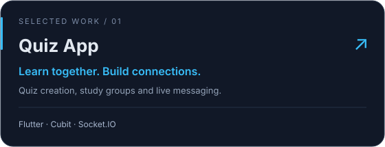
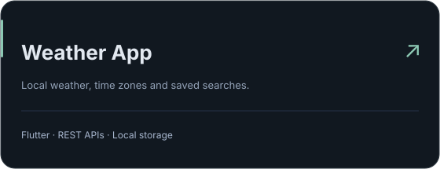
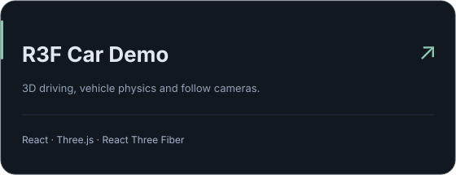

I work on Flutter apps at **DVA Holdings**, across DIVA Partner, DIVA Queen and SEEDO. My work includes mobile features, real-time communication, native integrations, backend APIs and Android/iOS releases.

### At work

- **DIVA Partner** — SIP/WebRTC calls, audio recording, KPI dashboards and staff workflows.
- **DIVA Queen** — loyalty campaigns, signature capture, shopping carts and payments.
- **SEEDO** — tenant onboarding, location-based attendance and session management.

I also contribute to the **Go / Hasura / PostgreSQL** backend and maintain release workflows with **GitHub Actions, Fastlane and Firebase App Distribution**.

### Stack

**Mobile** &nbsp; Flutter · Dart · BLoC/Cubit · GetIt · Freezed 
**Integration** &nbsp; GraphQL · REST · WebSocket · SIP/WebRTC 
**Data & delivery** &nbsp; Go · PostgreSQL · Firebase · SQLite · Hive · CI/CD

### Contributions

<picture>
  <source media="(prefers-color-scheme: dark)" srcset="./assets/contributions-dark.svg" />
  <source media="(prefers-color-scheme: light)" srcset="./assets/contributions.svg" />
  
</picture>

Generated daily from GitHub contribution data, including anonymized private activity.

### Personal projects

  
   
  
  

[All repositories](https://github.com/ystt1?tab=repositories)

Software Engineering · University of Information Technology, VNU-HCM
