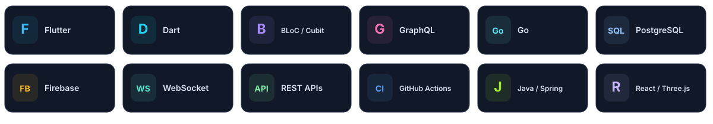

  

  <a href="#building-at-dva-holdings">What I build</a> &nbsp; · &nbsp;
  <a href="#my-toolbox">My toolbox</a> &nbsp; · &nbsp;
  <a href="#github-activity">GitHub activity</a> &nbsp; · &nbsp;
  <a href="#selected-work">Selected work</a>

 

### A little about me

I'm **Tuấn**, a Flutter / Mobile Developer. At **DVA Holdings**, I work on staff, customer and SaaS apps, with a focus on real-time features, native integrations and Android/iOS releases.

### Building at DVA Holdings

<table>
<tr>
<td width="33%" valign="top">

**DIVA Partner** 
*Staff & CRM*

VoIP calling, live call monitoring, audio recording, KPI dashboards and business workflows.

</td>
<td width="33%" valign="top">

**DIVA Queen** 
*Customer & Loyalty*

Campaigns, shake-to-win experiences, signature capture, shopping carts and checkout.

</td>
<td width="33%" valign="top">

**SEEDO** 
*SaaS Workforce*

Tenant onboarding, location-based attendance, session handling and workforce workflows.

</td>
</tr>
</table>

Also contributing to **Go / Hasura / PostgreSQL** and **Android / iOS delivery** with GitHub Actions, Fastlane and Firebase App Distribution.

### My toolbox

  

  BLoC / Cubit &nbsp; · &nbsp; Clean Architecture &nbsp; · &nbsp; SIP / WebRTC &nbsp; · &nbsp; WebSocket &nbsp; · &nbsp; REST &nbsp; · &nbsp; CI/CD

### GitHub activity

<picture>
  <source media="(prefers-color-scheme: dark)" srcset="./assets/contributions-dark.svg" />
  <source media="(prefers-color-scheme: light)" srcset="./assets/contributions.svg" />
  
</picture>

  Updated daily from GitHub, including anonymized private contributions.

### Selected work

  
   
  
  

  <a href="https://github.com/ystt1?tab=repositories">Explore all repositories ↗</a>

---

  Software Engineering · UIT, VNU-HCM &nbsp; / &nbsp; Flutter · Real-time · Mobile delivery

